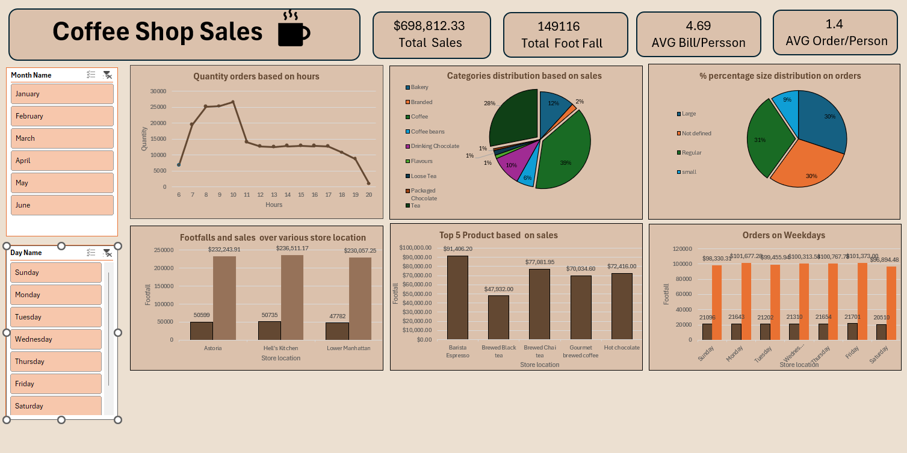

# Coffee-shop-sales

# ☕ Coffee Sales Analysis Dashboard

## 📌 Project Overview

This project analyzes coffee shop sales data to understand sales performance, customer footfall, product performance, and transaction trends.

The project uses **Excel** to clean, analyze, and visualize the data through an interactive dashboard.

## 🎯 Objectives

- Analyze total sales and revenue
- Track customer footfall
- Calculate average bill per transaction
- Analyze product and category performance
- Identify sales trends by day and time
- Understand customer purchasing patterns
- Create an interactive dashboard for business insights

## 🛠️ Tools & Technologies

- Microsoft Excel
- Excel Tables
- Pivot Tables
- Pivot Charts
- Slicers
- Excel Formulas
- Data Cleaning
- Data Analysis

## 📊 Key Metrics

The dashboard includes important KPIs such as:

- 💰 Total Sales
- 👥 Total Footfall
- 🧾 Average Bill
- 🛒 Average Quantity per Transaction
- 📦 Product Sales
- 📅 Sales by Day
- ⏰ Sales by Hour
- ☕ Product Category Performance

## 📈 Dashboard

The dashboard provides an interactive view of coffee shop sales performance.

## 🔍 Analysis

The analysis focuses on:

### Sales Analysis
- Total revenue generated
- Sales by product
- Sales by category
- Sales trends over time

### Customer Analysis
- Total number of transactions
- Customer footfall
- Average bill per transaction
- Average quantity purchased per transaction

### Time Analysis
- Sales by day of the week
- Sales by hour
- Peak sales periods

 

